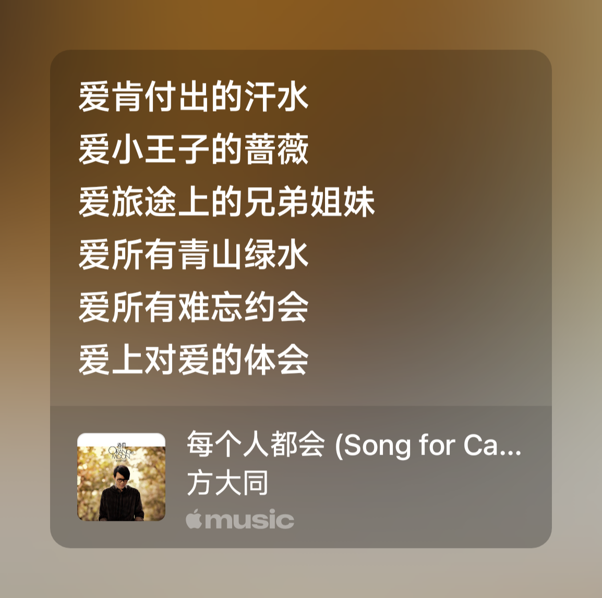

# Apple-Music-Share · 乐拾

把 Apple Music 分享的歌词卡片、音乐回忆等图片保存到相册，或转发给其他应用。

[下载 APK](https://github.com/champlus/Apple-Music-Share/releases/latest) · Android 10+

<p align="center">
  
</p>

## 使用

1. 安装乐拾。
2. 在 Apple Music 中分享歌词或音乐回忆，选择 **Instagram / Instagram 快拍**。
3. 在乐拾中预览，点击「保存」或「分享」。

歌词会自动与背景合成，四周留白约 10%；音乐回忆等完整图片保持原尺寸。界面只有预览、保存、分享，支持动态配色和深色模式。图片在本地处理，无网络权限，保存位置为 `Pictures/Apple-Music-Share`。

**为接收 Apple Music 的分享，应用使用 `com.instagram.android` 包名，不能与正版 Instagram 共存。** 这是个人制作的非官方工具。

## 构建

需要 JDK 17+、Python 3、Android SDK 36 和 Build Tools 36.1.0：

```sh
python3 build.py
```

首次构建会下载 Gradle 依赖，并生成本地签名密钥。APK 输出到 `dist/`；自行构建的签名与发布版不同，不能直接覆盖安装。
